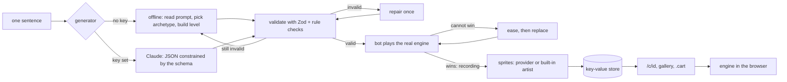

# Architecture

One page. The README has the stories; this is the map.

## The pieces

**Engine** (`src/engine`, 1,809 lines of which 248 are the chiptunes, no imports from outside the folder). `Engine.step(buttons)` advances one sixtieth of a second and depends only on the manifest and the buttons: no clock, no DOM, no `Math.random`, no trig. `Renderer.draw` writes palette indices into a 160 by 144 byte buffer. `Runner` is the only browser code: a `requestAnimationFrame` loop that feeds the fixed timestep and copies the buffer to a canvas through a four-entry lookup. `audio.ts` holds the four chiptune loops as text and plays them with WebAudio.

**Manifest** (`src/cart`). A cart is a map of up to 20 by 18 tiles, up to 40 entities each with one of eight behaviours (player, patrol, chase, falling, spawner, collectible, goal, hazard), four colours, and rules. The win rule is always the same: touch the goal while it is open. What opens it varies (always, after N pickups, at N points, after N seconds). `schema.ts` is the Zod schema plus the rules Zod cannot say. `repair.ts` is one deterministic pass that clamps, pads, dedupes and digs things out of walls.

**Generators** (`src/gen`). Both return `unknown` and are trusted equally, which is not at all. The offline one reads the sentence with patterns (`brief.ts`), then builds one of seven level archetypes from a seed that is the hash of the prompt (`offline.ts`). The Anthropic one sends the same schema as a structured-output constraint. `pipeline.ts` runs generate, validate, repair, play.

**Bot** (`src/bot`). Best-first search over held button combinations on the real engine, backing up with snapshots. A position is the player's 4 pixel cell, vertical speed, a time bucket, and a hash of remaining pickups and chaser cells, packed into one number. The heuristic is a flood-fill distance to the nearest thing the goal rule still needs. A cart counts as winnable only when the recording replays to a win on a fresh engine with no life lost.

**Sprites** (`src/sprites`). `slice.ts` and `quantize.ts` turn a generated sheet into cells: key out magenta, pick four colours from flat areas, pair them with the palette, shrink each cell by majority vote. `synth.ts` is the built-in artist: 36 hand-authored shapes chosen by keyword, with seeded variation. `sheet.ts` chooses between them and caches provider results by prompt hash.

**Web** (`src/app`, `src/components`, `src/lib/service.ts`). Next.js App Router. `CartService` is the only thing routes talk to.

## Invariants

- Same manifest and same buttons give the same frames, in Node and in every browser. Positions are multiples of 1/64 pixel, so floats never drift.
- A cart's id is a hash of its contents. Carts are never edited, so `/c/<id>` can be cached forever.
- Nothing a generator returns is executed. The worst a bad manifest can do is fail validation.
- Every stored cart has a recording that wins it.
- A file in `assets/generated` overrides the same path in `assets/interim`, one file at a time.

## Storage

| Key | Value | Notes |
|---|---|---|
| `cart-<id>` | manifest, packed sheet, winning recording, generation report | written once |
| `recent` | up to 50 summaries, newest first | one writer at a time, through a promise queue |
| `sheet-<hash>` | packed sheet | only for provider-generated sheets, keyed by prompt hash |

`KV` has three implementations: memory (tests), one JSON file per key under `.data` (default), and a REST client for Upstash or Vercel KV.

## Decisions I would revisit

- The bot gives up after 80,000 expansions and the cart is eased. A better heuristic for chasers would ease fewer carts.
- Only expanded search nodes keep a snapshot. A child is re-simulated from its parent when it is popped, which costs one extra simulation per expansion and saves most of the memory.
- The file store is right for one process and wrong for serverless. The REST slot is there for that and has never been run against a real service.
