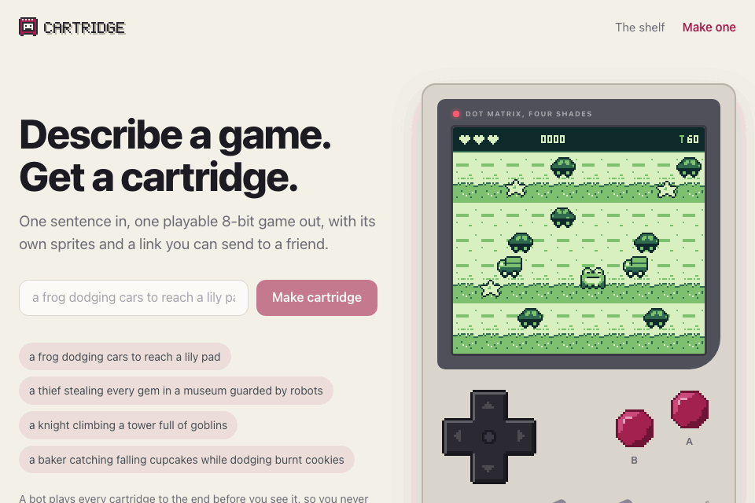
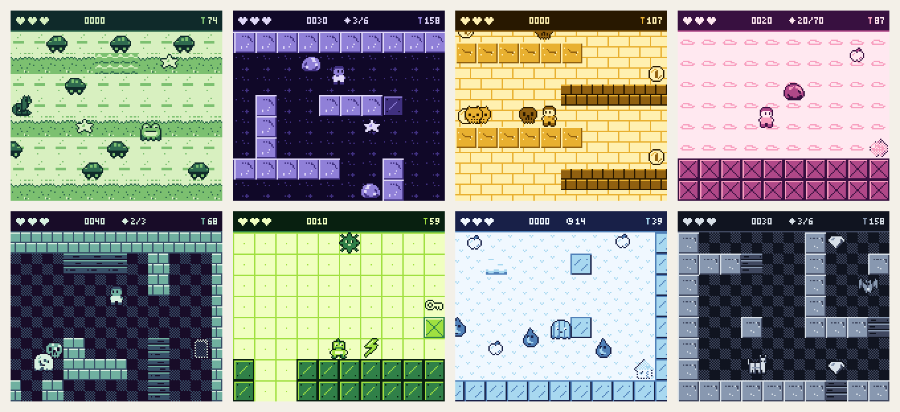
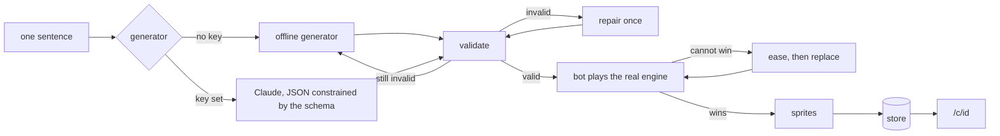
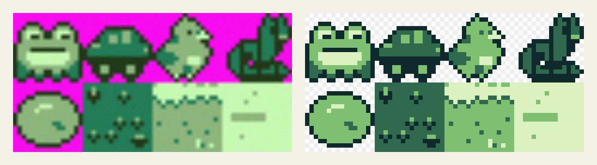

<div align="center">

# Cartridge

### a sentence becomes an 8-bit game that a bot has already beaten

[](tsconfig.json)
[](src/engine)
[](tests)
[](LICENSE)

<br>



</div>

<br>

Type a sentence, something like *a frog dodging cars to reach a lily pad*, and a few milliseconds later you have a small game. It runs at 160 by 144 pixels in four colours and takes a d-pad and two buttons. Its link is short enough to text.

Nothing in that process writes game code. The generator fills in a form I call a manifest: a tile map, a cast of entities that each pick one behaviour from a list of eight, four colours, and a rule for winning. An engine I wrote by hand runs it. The worst thing a bad manifest can do is fail validation.

Every cart is also played to the end before you see it. A bot searches the real engine for a winning run, and the recording of that run is stored with the cart. Press "Watch the bot win" on any cart page to see the proof replayed, and press any button to take over from wherever the bot has got to.

A caveat that belongs up here: the machine this was built on had no API keys. The Claude generator is written and tested against a stub, but it has never made a live call. What runs by default is an offline generator that reads your sentence with patterns and word lists, and every number in this README was measured on that one.

<p align="center"></p>
<p align="center"><sub>Eight prompts, eight carts, each caught a third of the way through the bot's winning run.</sub></p>

<br>

## Table of contents

- [Run it](#run-it)
- [What fits on a cartridge](#what-fits-on-a-cartridge)
- [From sentence to cart](#from-sentence-to-cart)
- [The bot](#the-bot)
- [Sprites](#sprites)
- [The parts that fought back](#the-parts-that-fought-back)
- [Acceptance tests](#acceptance-tests)
- [Limitations](#limitations)
- [Next](#next)
- [Layout](#layout)

<br>

## Run it

```bash
git clone https://github.com/ayaan-gupta/cartridge && cd cartridge && npm install && npm run dev
```

Open http://localhost:4103. There is no key to set and no database to start. Carts are written as JSON files under `.data/`.

Everything below is optional and documented in [.env.example](.env.example).

| Variable | What it turns on |
|---|---|
| `ANTHROPIC_API_KEY` | Claude writes the manifest (model `claude-sonnet-5-5` unless `CARTRIDGE_MODEL` says otherwise) |
| `SPRITE_API_KEY` | one generated sprite sheet per cart, through any API that speaks the OpenAI images protocol |
| `KV_REST_API_URL` and `KV_REST_API_TOKEN` | a hosted key-value store in place of the local files |
| `PORT` | a different port, as in `PORT=4200 npm run dev` |

Useful scripts: `npm test`, `npm run eval` for the 50-prompt run, `npm run eval -- --random 400` for prompts nobody tuned for, and `npm run bench` to time a frame in Node.

<br>

## What fits on a cartridge

The limits are borrowed from a certain grey handheld from 1989, and they are the reason this works at all. A small enough box can be searched and repaired by ordinary code.

| | |
|---|---|
| Screen | 160 by 144, drawn as palette indices into a byte buffer |
| Colours | four per cart |
| Sprites | 16 by 16, packed at 2 bits a pixel |
| Map | 10 by 8 up to 20 by 18 tiles |
| Entities | up to 40 in the manifest, 64 alive at once |
| Behaviours | player, patrol, chase, falling, spawner, collectible, goal, hazard |
| Winning | touch the goal while it is open. It opens straight away, after N pickups, at N points, or after surviving N seconds |
| Losing | run out of lives or time |
| Controls | d-pad, A and B |
| Music | one of four chiptune loops |

The whole manifest for the frog cart is 2,331 bytes. Add the sprite sheet and the bot's recording and a downloadable `.cart` file averages 3.3 KB.

The engine itself is [1,809 lines in one folder](src/engine) that imports nothing from outside it. `Engine.step(buttons)` advances one sixtieth of a second using only the manifest and the buttons. It never reads a clock, touches the DOM, calls `Math.random` or uses trig, and positions are stored in 64ths of a pixel so floats cannot drift. The same manifest with the same inputs gives the same frames in Node and in a browser, which is the property the bot and every replay lean on.

<br>

## From sentence to cart



1. **Generate.** Either generator returns `unknown`, and both get exactly as much trust as that type implies.
2. **Validate.** A Zod schema catches shape. Hand-written checks catch what a schema cannot say, such as a chaser faster than the player or a goal sealed inside a wall.
3. **Repair, once.** One deterministic pass clamps numbers, pads short rows, removes spare players and digs entities out of walls. If the result is still invalid the offline generator takes over.
4. **Play.** The bot has to win. When it cannot, the cart is eased (slower enemies, more time) and tried again, and replaced outright as a last resort.
5. **Draw and store.** Sprites are attached, the cart is hashed, and the hash becomes its id. Carts are never edited, so `/c/<id>` can be cached forever.

The offline generator deserves a plain description, because the name flatters it. It pulls a hero and a setting out of the sentence with patterns, picks one of seven level archetypes (crossing traffic, a maze, a platformer, a climb, an escape, catching falling things, surviving a timer), and builds the level from a seed that is the hash of the prompt. The same sentence always gives the same game.

<br>

## The bot

A best-first search over held button combinations, run on the real engine with snapshots to back up from. A state is the player's 4 pixel cell, vertical speed, a time bucket, and a hash of which pickups remain and where the chasers are. The heuristic is a flood-fill distance to the nearest thing the win rule still needs.

A cart counts as winnable only when the recording, replayed on a fresh engine, reaches the goal without losing a life. Six manifests in the test suite are built to be impossible, and the bot refuses all six.

Two honest notes. The bot proves a cart *can* be won, which is a long way from proving it is fun. It also plays with frame-exact input and never touches B, so its idea of "fair" is stricter in some ways and looser in others than a person's thumbs.

<br>

## Sprites

The PRD asks for one generated sprite sheet per cart: eight drawings on flat magenta, sliced and reduced to the cart's four colours. That pipeline is built. Magenta is keyed out, four colours are estimated, each is paired with a palette slot, and every cell is shrunk to 16 by 16 by majority vote.

<p align="center"></p>
<p align="center"><sub>Left: a sheet I drew in code and then deliberately ruined with blur and wrong colours. Right: what the slicer hands the engine.</sub></p>

With no image key set, a built-in artist draws the sheet from [36 hand-authored shapes](docs/sprites.png) chosen by keyword, with seeded variation in the markings. That is what you see in every screenshot here.

Design-time art follows the brief's rule: I cannot generate images, so the seven I wanted (logo, d-pad, button, two illustrations, two sprite sheets) are requested in [assets/prompts.md](assets/prompts.md) with exact prompts and sizes. Code-drawn stand-ins live in `assets/interim`. A file saved to `assets/generated` replaces its stand-in on the next request.

<br>

## The parts that fought back

**An imported constant cost twentyfold in the pixel loop.** The first benchmark took 650 microseconds to draw a frame of 23,040 pixels, which is slow enough to be suspicious. The CPU profile listed `TILE` and `SCREEN_W` among the hottest "functions". Under tsx and vitest, `import { TILE }` compiles to a getter on a module object, and the renderer was calling that getter once per pixel. Copying the constants into module-level locals took drawing down to 30 microseconds. A production bundle never had the problem. The bot and the tests run in Node, though, and that is where a cart gets proven.

**Soft edges outvoted the outline.** My first slicer run recovered 80.3% of pixels correctly from the ruined sheet above. Shapes were perfect and colours were wrong: the two darkest tones had merged into one. Blur a one-block dark outline against a light fill and you create more in-between pixels than outline pixels, so the smear won a palette slot and the real outline lost its own. The fix was to estimate colours only from flat pixels, meaning pixels that agree with their neighbours two steps away, and then run a few rounds of k-means. Recovery went above 99%. The same test shows why plain median cut fell short: when one colour covers 87% of the sheet, the population median lands inside it and half the boxes are spent on a single tone.

**The bot called slow players stuck.** A cart with a hero moving at 30 pixels a second was declared unwinnable with the goal in plain sight. The search held each input for 6 frames and remembered visited positions in 4 pixel cells. Six frames at half a pixel each is 3 pixels, so most moves ended in the cell they started from and were discarded as already seen. Hold length now scales with speed until every move covers about half a tile.

**Quick taps never reached the game.** A smoke script drives the play page with real touch events on an emulated phone, and tapping A did nothing. The tap went down and came back up between two simulation steps, and the runner only sampled buttons at step time. It now remembers a press until one step has seen it. The same script caught the handheld measuring its own container to choose a scale. Since the container was sized by the handheld, the two agreed with each other forever and the console sat at 2x on a window with room for 3x.

**How hard should the bot try?** At 40,000 expansions it failed 4 of the 50 prompts. One maze was fine and simply needed 75,097. Another was still unsolved at 600,000, because the generator had parked a chaser beside a pickup. That is a puzzle about luring the chaser away, and a greedy search does not lure. I raised the budget to 80,000, stopped the generator from guarding pickups that closely, and let anything still unsolved be eased.

**The prompt reader had opinions.** "Knight" contains "night", so a castle cart came out as a dark world. "Duckling" and "lightning" were thrown away as verbs ending in -ing. A ghost escaping a haunted mansion chased by vampires produced an enemy named "haunted mansion chased", and *survive a meteor shower* was proudly titled SHOWER SHOWER.

A smaller one, for the typographers: a 3 pixel wide N is either a lowercase n or an M. KNIGHT ASCENT read as KMIGHT ASCEMT until three letters were given a fourth column.

<br>

## Acceptance tests

| PRD test | Result | Measured |
|---|---|---|
| 50 varied prompts give 50 valid manifests, 95% first try and 100% after repair | Met on the offline generator. Never run against Claude. | 50 of 50 valid on the first try, 0 template fallbacks |
| Every generated cart is winnable by a bot within the time limit | Met | 50 of 50 won as generated, each recording replayed on a fresh engine with no life lost |
| Engine holds 60 FPS on a mid-range phone | Met in emulation only. No physical phone was involved. | 0.14 to 0.39 ms of work per frame across runs, against a 16.67 ms budget. Worst single frame 6.7 ms. 0 of 300 frames late on four carts under a 4x CPU throttle |
| A cart's JSON stays under 20 KB without images | Met | mean 1,444 bytes, largest 2,708 |

Three of those rows need their fine print.

The first-try figure is 100% by construction. The offline generator was written against the same schema it is being checked by, so a failure there would be a bug and says nothing about how often a language model gets it right. `npm run eval -- --live` runs the identical 50 prompts against Claude once a key exists. To exercise repair anyway, the tests take 50 good manifests and break each with one to three faults drawn from a list of 32 (missing keys, wrong types, extra players, entities inside walls). 49 came out invalid, and a single repair pass fixed all 49.

I also tuned against those 50 prompts. Before two fixes, only 46 were winnable as generated. For a less flattering sample, `npm run eval -- --random 400` stitches 400 sentences together from word lists: all 400 valid, 391 won as generated, the other 9 won after easing, none replaced.

The phone number comes from headless Chromium at 390 by 844 with the main thread throttled 4x through the DevTools protocol. That slows JavaScript. It does not model a phone GPU or thermal throttling. The numbers also wandered with machine load, and one early run recorded a 12.2 ms frame that never came back. A typical frame costs about 2% of the budget even throttled, so the meaningful half of the result is that frames arrive on time.

<br>

## Limitations

- **The Claude generator has never called the API.** Its request shape is tested with a stub client. The structured-output schema is derived from the Zod schema with unsupported keywords moved into descriptions, which is my reading of the documentation and has not been watched working.
- **The image provider has never called an API either.** The slicer has only met sheets I drew in code to look generated. Real model output will bring problems those lack, such as drawings that cross cell borders or magenta inside a sprite.
- **The offline generator does not understand your sentence.** It matches keywords into seven archetypes, and a prompt with no keywords gets an archetype picked by hash. "Something with a dinosaur" becomes a maze called DINOSAUR HUNT.
- **Built-in sprites repeat.** There are 18 character shapes and 8 goal shapes, so two carts about cats share a silhouette with different markings. Animation is a one pixel bob.
- **Nobody has listened to the chiptunes.** They parse and schedule correctly and all four are eight bars long. I had no way to hear them, so they may be terrible.
- **60 FPS was measured in an emulated phone in one browser engine.** Safari and Firefox are untested.
- **It is not ready for the open internet.** `POST /api/carts` has no rate limit and prompts appear in the gallery unmoderated. The file store suits one process on one machine, and the hosted store client has never touched a real service.
- **No Rust or WASM port.** The PRD lists it as optional and the machine had no Rust toolchain.

<br>

## Next

1. Port the simulation to Rust and WASM, with the stored bot recordings as the test suite. Two engines that must agree frame for frame on every cart is a far better spec than any I could write.
2. Run the live evaluation, then give Claude the bot's verdict. When a cart cannot be won, send back where the bot got stuck and ask for a second draft instead of quietly easing the first.
3. A remix button on every share link: open the map in a small touch editor and have the bot re-check winnability as you move things.

<br>

## Layout

```
src/engine/      fixed-step simulation, renderer, 5 pixel font, runner, chiptunes
src/cart/        manifest schema, rule checks, one-pass repair, three hand-written carts
src/gen/         offline and Claude generators, the generate/validate/repair/play pipeline
src/bot/         the search that proves a cart can be won
src/sprites/     slicing, colour reduction, the built-in artist, the image provider adapter
src/store/       key-value stores behind one interface
src/app/         Next.js routes: home, /c/<id>, /gallery, the API
scripts/         eval, bench, perf, smoke, screenshots, demo recording
tests/           148 tests, including one that drives a throttled browser
assets/          prompts.md (image requests), interim/ (code-drawn stand-ins)
```

[ARCHITECTURE.md](ARCHITECTURE.md) has the invariants and the storage keys on one page.

## License

MIT. See [LICENSE](LICENSE).
